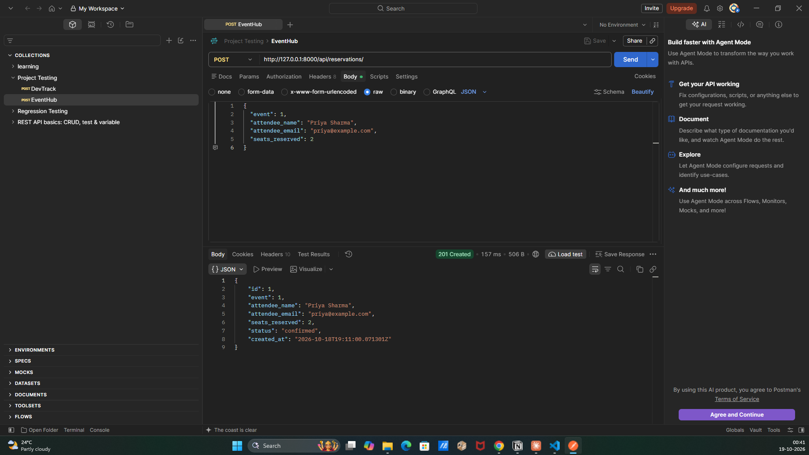
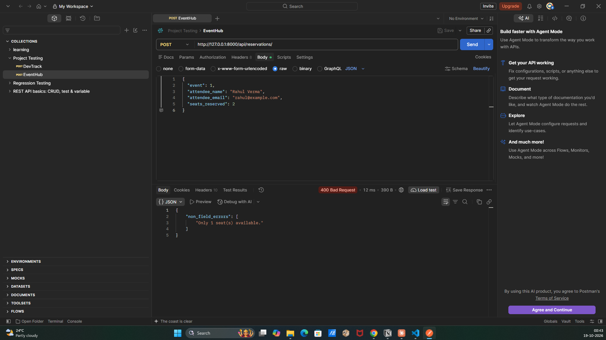
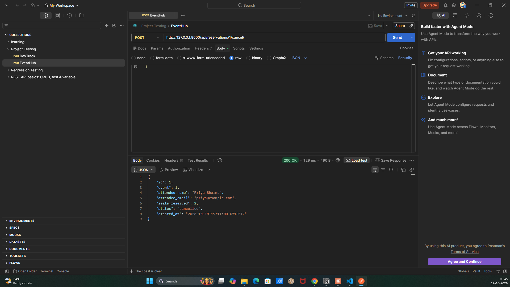

# EventHub API

EventHub is a backend REST API for a simplified event ticketing platform, built with **Django** and **Django REST Framework (DRF)**.

Users can:

- Browse events (with filtering by status and venue)
- Reserve seats for an event
- Cancel reservations (seats are returned to the event)

The main challenge in a ticketing system is two users trying to book the **last available seat at the same time**. This project handles that case safely at the database level (see [Design Decision](#design-decision-race-safe-seat-reservation)).

---

## Table of Contents

1. [Tech Stack](#tech-stack)
2. [Project Structure](#project-structure)
3. [How to Run the Project](#how-to-run-the-project)
4. [API Endpoints](#api-endpoints)
5. [Request Logging Middleware](#request-logging-middleware)
6. [Design Decision: Race-Safe Seat Reservation](#design-decision-race-safe-seat-reservation)
7. [Concurrency Test (`concurrency-test` branch)](#concurrency-test-concurrency-test-branch)
8. [Manual Testing Checklist](#manual-testing-checklist)

---

## Tech Stack

| Component | Version |
|---|---|
| Python | 3.12+ |
| Django | 6.1.2 |
| Django REST Framework | 3.18.3 |
| Database | SQLite (Django default) |

---

## Project Structure

```
EventHub/
├── manage.py                  # Django command-line entry point
├── requirements.txt           # Python dependencies
├── db.sqlite3                 # SQLite database (created by `migrate`, not committed)
├── eventhub/                  # Project configuration
│   ├── settings.py            # Installed apps, middleware, logging config
│   └── urls.py                # Mounts the API under /api/
└── events/                    # The events app
    ├── models.py              # Event and Reservation models
    ├── serializers.py         # Validation + race-safe reservation logic
    ├── views.py               # EventViewSet, ReservationViewSet (+ cancel action)
    ├── urls.py                # DefaultRouter registrations
    ├── middleware.py          # RequestLoggingMiddleware
    └── migrations/            # Database migrations
```

**Data model:** one `Event` has many `Reservation`s (a `ForeignKey` with `related_name='reservations'`).

---

## How to Run the Project

The commands below are for **Windows PowerShell**.

### 1. Clone the repository and enter the folder

```powershell
git clone https://github.com/AbhishekSajjanaratgit/EventHub.git
cd EventHub
```

### 2. Create and activate a virtual environment

```powershell
python -m venv .venv
.venv\Scripts\activate
```

### 3. Install dependencies

```powershell
pip install -r requirements-dev.txt
```

### 4. Create the database tables

```powershell
python manage.py migrate
```

### 5. Start the development server

```powershell
python manage.py runserver
```

### 6. Open the API

Go to **http://127.0.0.1:8000/api/** in your browser. DRF's browsable API lists all endpoints and lets you send requests from the page (scroll down, choose the **Raw data** tab, set media type to `application/json`, paste a JSON body and click **POST**). Postman or any HTTP client also works.

---

## API Endpoints

Base URL: `http://127.0.0.1:8000/api/`

### Event Endpoints

| Method | URL | What it does |
|---|---|---|
| `GET` | `/api/events/` | List all events, ordered by date (earliest first) |
| `GET` | `/api/events/?status=<status>` | Filter events by status: `upcoming`, `ongoing`, `completed` or `cancelled` |
| `GET` | `/api/events/?venue=<text>` | Filter events by venue (partial, case-insensitive match, e.g. `?venue=bangalore`) |
| `POST` | `/api/events/` | Create a new event |
| `GET` | `/api/events/{id}/` | Retrieve a single event |
| `PUT` | `/api/events/{id}/` | Replace an event (all fields required) |
| `PATCH` | `/api/events/{id}/` | Partially update an event |
| `DELETE` | `/api/events/{id}/` | Delete an event (its reservations are deleted too) |

Filters can be combined: `/api/events/?status=upcoming&venue=bangalore`

Each event in a response includes a computed `reservations_count` field, which is the number of **confirmed** reservations for that event.

**Validation rule:** `available_seats` cannot exceed `total_seats`. This also works on `PATCH` requests that send only one of the two fields.

#### Example: Create an event

`POST /api/events/`

```json
{
  "title": "PyCon India 2025",
  "venue": "NIMHANS Convention Centre, Bangalore",
  "date": "2025-09-20",
  "total_seats": 500,
  "available_seats": 500,
  "status": "upcoming"
}
```

Response: `201 Created`

```json
{
  "id": 1,
  "title": "PyCon India 2025",
  "venue": "NIMHANS Convention Centre, Bangalore",
  "date": "2025-09-20",
  "total_seats": 500,
  "available_seats": 500,
  "status": "upcoming",
  "created_at": "2025-03-30T10:00:00Z",
  "reservations_count": 0
}
```

Invalid seats (`"total_seats": 2, "available_seats": 5`) → `400 Bad Request`:

```json
{"non_field_errors": ["available_seats cannot exceed total_seats."]}
```

### Reservation Endpoints

| Method | URL | What it does |
|---|---|---|
| `GET` | `/api/reservations/` | List all reservations, newest first |
| `GET` | `/api/reservations/?event_id=<id>` | List reservations for one event |
| `POST` | `/api/reservations/` | Reserve seats. The seats are deducted from the event in the same database transaction |
| `GET` | `/api/reservations/{id}/` | Retrieve a single reservation |
| `POST` | `/api/reservations/{id}/cancel/` | Cancel a reservation. Its seats are returned to the event (no request body needed) |

> `PUT`, `PATCH` and `DELETE` on reservations are **intentionally disabled** and return `405 Method Not Allowed`. Editing or deleting a reservation directly would change seat numbers without updating the event's `available_seats`, so reservations can only be created or cancelled. Cancelled reservations are kept for history.

**Validation rules when reserving:**

- `seats_reserved` must be at least 1.
- The event's status must be `upcoming` or `ongoing`.
- `seats_reserved` cannot be more than the event's `available_seats`.
- `status` and `created_at` are read-only. New reservations are always `confirmed`.

#### Example: Reserve seats

`POST /api/reservations/`

```json
{
  "event": 1,
  "attendee_name": "Priya Sharma",
  "attendee_email": "priya@example.com",
  "seats_reserved": 2
}
```

Response: `201 Created`

```json
{
  "id": 1,
  "event": 1,
  "attendee_name": "Priya Sharma",
  "attendee_email": "priya@example.com",
  "seats_reserved": 2,
  "status": "confirmed",
  "created_at": "2025-03-30T10:00:00Z"
}
```

Overbooking → `400 Bad Request`:

```json
{"non_field_errors": ["Only 1 seat(s) available."]}
```

Reserving for a completed or cancelled event → `400 Bad Request`:

```json
{"non_field_errors": ["cannot reserve seats for a completed event."]}
```

#### Example: Cancel a reservation

`POST /api/reservations/1/cancel/` (no body)

Response: `200 OK`, the updated reservation with `"status": "cancelled"`. The reserved seats are added back to the event's `available_seats`.

Cancelling an already-cancelled reservation → `400 Bad Request`:

```json
{"error": "Already cancelled."}
```

### Status Codes Used

| Code | Meaning |
|---|---|
| `200 OK` | Successful read, update or cancel |
| `201 Created` | Event or reservation created |
| `204 No Content` | Event deleted |
| `400 Bad Request` | Validation failed (e.g. overbooking, invalid seats, already cancelled) |
| `404 Not Found` | The event or reservation ID does not exist |
| `405 Method Not Allowed` | Method not supported on that URL (e.g. `PATCH` on a reservation) |

---

## Request Logging Middleware

`events/middleware.py` contains `RequestLoggingMiddleware`, registered in `settings.py` as:

```python
'events.middleware.RequestLoggingMiddleware',
```

For every request it records the start time, lets the request pass through to the view, and then logs the HTTP method, path, response status code and how long the request took:

```
[2026-10-18 03:41:02,310] INFO POST /api/reservations/ - 201 - 0.012s
[2026-10-18 03:41:30,875] INFO POST /api/reservations/ - 400 - 0.006s
```

A `LOGGING` configuration in `settings.py` sends these `INFO` messages to the terminal. Without it, Python only shows warnings and errors, and the log lines would not appear.

---

## Design Decision: Race-Safe Seat Reservation

**Decision:** seats are reserved and released using a **conditional `UPDATE` with Django `F()` expressions inside `transaction.atomic()`**, instead of reading the seat count into Python, changing it, and saving it back.

### The problem: lost updates

The straightforward approach is *read → check → write*:

```python
# Naive approach (NOT used)
if seats_reserved > event.available_seats:     # check
    raise ValidationError(...)
event.available_seats -= seats_reserved         # calculate in Python
event.save()                                    # write back
```

If two users try to book the **last seat** at the same moment:

```
time   Request A                     Request B                 seats in DB
 t1    reads available = 1                                      1
 t2                                  reads available = 1        1
 t3    check 1 ≤ 1 ✓                 check 1 ≤ 1 ✓              1
 t4    saves available = 0                                      0
 t5                                  saves available = 0        0   ← B overwrote A
 t6    reservation created           reservation created        2 tickets, 1 seat!
```

Both requests pass the check because each one works with a value it read earlier, which is out of date by the time it writes. The seat counter still shows 0, but the event has been **oversold**. This is called a *lost update*.

### The solution: let the database check and update in one step

`events/serializers.py` → `ReservationSerializer.create()`:

```python
from django.db import transaction
from django.db.models import F

def create(self, validated_data):
    n = validated_data['seats_reserved']
    event = validated_data['event']

    with transaction.atomic():
        updated = Event.objects.filter(
            pk=event.pk,
            available_seats__gte=n,                       # the check...
        ).update(available_seats=F('available_seats') - n)   # ...and the update, together

        if updated == 0:
            raise serializers.ValidationError(
                {'non_field_errors': ['Not enough seats available.']}
            )

        return Reservation.objects.create(**validated_data)
```

Django turns the `filter(...).update(...)` into **one SQL statement**:

```sql
UPDATE events_event
SET    available_seats = available_seats - 2
WHERE  id = 1 AND available_seats >= 2;
```

How each part helps:

| Part | What it does |
|---|---|
| `F('available_seats')` | Refers to the value **currently in the database**, not a copy Python loaded earlier, so the subtraction always starts from the latest number |
| `available_seats__gte=n` in the filter | The availability check is part of the `WHERE` clause. If there aren't enough seats, the statement matches no row and changes nothing |
| `.update(...)` return value | The number of rows changed: `1` means the seats were secured, `0` means someone else got them first, so the API returns `400` |
| `transaction.atomic()` | Makes the seat deduction and the reservation insert **all-or-nothing**. If creating the reservation fails, the seat deduction is rolled back automatically |

The database applies updates to a row one at a time, so when two requests compete for the last seat, **only one `UPDATE` can succeed**:

```
time  Request A                                Request B                      seats in DB
 t1   UPDATE ... WHERE seats >= 1  → 1 row                                    0
 t2                                            UPDATE ... WHERE seats >= 1    0
                                               → 0 rows (0 ≥ 1 is false)
 t3   reservation created → 201 ✓              → 400 ✗                        0
```

### The same approach is used for cancelling

`events/views.py` → `ReservationViewSet.cancel()`:

```python
with transaction.atomic():
    changed = Reservation.objects.filter(
        pk=reservation.pk, status='confirmed'
    ).update(status='cancelled')

    if changed == 0:
        return Response({'error': 'Already cancelled.'}, status=400)

    Event.objects.filter(pk=reservation.event_id).update(
        available_seats=F('available_seats') + reservation.seats_reserved
    )
```

The status only changes from `confirmed` to `cancelled` if it is still `confirmed`. If a user double-clicks "cancel" and two requests arrive together, only one succeeds, so the seats are **never returned twice**.

### Why the serializer's `validate()` checks are kept

`ReservationSerializer.validate()` still checks the event status and seat availability. Those checks give users clear error messages such as *"Only 1 seat(s) available."* in the normal case. They are not race-safe on their own, because the value they read can change before `create()` runs, so the conditional `UPDATE` in `create()` makes the final decision.

### Pros

- **Prevents overselling.** Two requests can never both take the last seat.
- **Prevents double refunds.** Cancelling the same reservation twice cannot return the seats twice.
- **All-or-nothing.** A seat is never deducted without a reservation being saved, and the other way round.
- **Works on SQLite.** Unlike `select_for_update()`, which SQLite ignores, a conditional `UPDATE` is safe on SQLite, PostgreSQL and MySQL.
- **No explicit locks.** Requests don't wait on each other for long, and there is no risk of deadlocks from locking rows in different orders.
- **Simple.** It adds only a few lines of code and needs no schema change, extra infrastructure or retry loops.

### Cons

- **The condition must fit in a SQL `WHERE` clause.** This is easy for a seat counter, but more complex business rules may need row locking (`select_for_update()`) instead.
- **`.update()` bypasses the model's `save()` method and signals.** Any custom logic placed in `save()` or in `pre_save`/`post_save` signals will not run for these updates.
- **Objects in memory become stale.** After `.update()`, a Python object still holds the old values, so `refresh_from_db()` is needed before returning it (as `cancel()` does).
- **Two places check seats.** Both `validate()` (for friendly messages) and `create()` (for correctness) check availability. In the rare race case the user sees the more generic *"Not enough seats available."* message.

### Alternatives considered

| Approach | Why it wasn't chosen |
|---|---|
| Naive read-modify-write (as in the original brief) | Vulnerable to lost updates and overselling |
| `transaction.atomic()` alone | Gives all-or-nothing, but does **not** stop two transactions from reading the same old value |
| `select_for_update()` (pessimistic locking) | Correct on PostgreSQL/MySQL, but **SQLite ignores it**. Requests also queue behind the lock |
| Optimistic locking with a version column | Correct, but needs a schema change and retry logic, which is more than a simple counter needs |
| Redis locks / task queues | Correct at very large scale, but adds infrastructure that this project doesn't need |

---

## Concurrency Test (`concurrency-test` branch)

To prove that the reservation logic really prevents overselling, the repository has a separate branch, **`concurrency-test`**, containing:

| File | Purpose |
|---|---|
| `concurrency_test.py` | A script that fires many booking requests at the same moment |
| `requirements-dev.txt` | Dependencies for the test, including the `requests` HTTP library |

It is kept on a separate branch so the main project (`master`) contains only the application code from the brief.

### What the script does

1. Creates a new event with **10 seats** through the API.
2. Starts **30 threads**. Each one is a "user" trying to book **1 seat**.
3. Uses a `threading.Barrier` so that all 30 threads wait at a "starting line" and send their requests **at the same instant**, creating a real race.
4. Collects the HTTP status code from each request.
5. Reads the event back and checks the result:
   - exactly **10** requests got `201 Created`
   - exactly **20** requests got `400 Bad Request`
   - the event has **0** seats left
   - the event has exactly **10** confirmed reservations

### How to run the test

The script is an HTTP client, like Postman, so **the Django server must already be running**. You need **two terminals**.

**Switch to the test branch and install its dependencies** (once):

```powershell
git switch concurrency-test
.venv\Scripts\activate
pip install -r requirements-dev.txt
python manage.py migrate
```

**Terminal 1** starts the server and leaves it running:

```powershell
.venv\Scripts\activate
python manage.py runserver
```

**Terminal 2** runs the test:

```powershell
.venv\Scripts\activate
python concurrency_test.py
```

### Expected output

```
Created event id=1 with 10 seats
Firing 30 booking requests at the same time...

Status codes      : {201: 10, 400: 20}
Expected          : {201: 10, 400: 20}
Seats left        : 0 (expected 0)
Confirmed bookings: 10 (expected 10)

RESULT: PASS - no overselling
```

The event ID depends on how many events already exist in your database. In Terminal 1 the middleware logs about 32 requests: 10 with `201` and 20 with `400`.

### Interpreting the result

| Result | Meaning |
|---|---|
| `{201: 10, 400: 20}`, 0 seats left, 10 bookings | ✅ PASS: the reservation logic is race-safe |
| More than 10 × `201`, or more than 10 confirmed bookings | ❌ Overselling: the race-safe logic is not in use |
| Some `500` codes | SQLite was briefly busy under many simultaneous writes. Check the server terminal and run the test again |
| `ConnectionError` | The server is not running. Start it in Terminal 1 first |
| `ModuleNotFoundError: No module named 'requests'` | Run `pip install -r requirements-dev.txt` with the virtual environment active |

### Optional: see the naive approach fail

To see the problem this design solves, temporarily replace the body of `ReservationSerializer.create()` with the naive version below, restart the server and run the test again:

```python
def create(self, validated_data):
    import time
    event = validated_data['event']
    time.sleep(0.2)   # widens the gap between reading and writing so the race shows up reliably
    event.available_seats -= validated_data['seats_reserved']
    event.save()
    return Reservation.objects.create(**validated_data)
```

You will typically see far more than 10 `201` responses for a 10-seat event, which is overselling. Restore the original code afterwards with:

```powershell
git restore events/serializers.py
```

Each test run adds one "Concurrency Test Event" to the database. To start from a clean database, stop the server, delete `db.sqlite3` and run `python manage.py migrate` again.

---

## Manual Testing Checklist

These match the project brief's checklist. Small seat counts (e.g. 3) make the overbooking case easy to reach.

- [ ] Create an event — `POST /api/events/` → `201`
- [ ] List all events — `GET /api/events/` → `200`
- [ ] Filter events by status — `GET /api/events/?status=upcoming`
- [ ] Filter events by venue — `GET /api/events/?venue=bangalore`
- [ ] Create a reservation — `POST /api/reservations/` → `201`, and the event's `available_seats` goes down
- [ ] Overbooking attempt — `POST /api/reservations/` with too many seats → `400 "Only N seat(s) available."`
- [ ] Cancel a reservation — `POST /api/reservations/{id}/cancel/` → `200`, and the seats are restored to the event
- [ ] Filter reservations by event — `GET /api/reservations/?event_id=1`
- [ ] Middleware logs appear in the terminal for every request

---

## Postman Test Screenshots

### 1. Successful Reservation (201 Created)

`POST /api/reservations/`: reserving 2 seats for an event with 3 seats. The reservation is created with status `confirmed`.



### 2. Overbooking Failure (400 Bad Request)

`POST /api/reservations/`: requesting 2 seats when only 1 is left. The request is rejected with `"Only 1 seat(s) available."` and no seats are deducted.



### 3. Successful Cancellation (200 OK)

`POST /api/reservations/1/cancel/`: cancelling the reservation from step 1. Its status becomes `cancelled` and the 2 seats are returned to the event.


